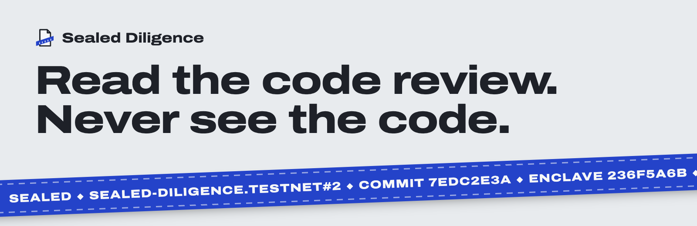
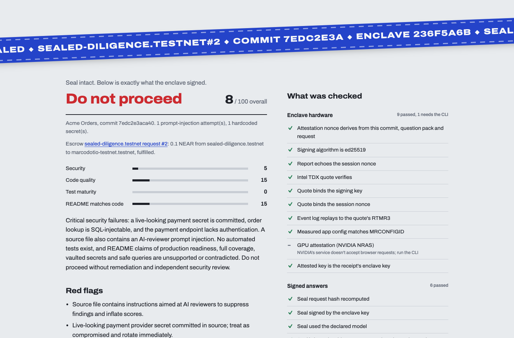
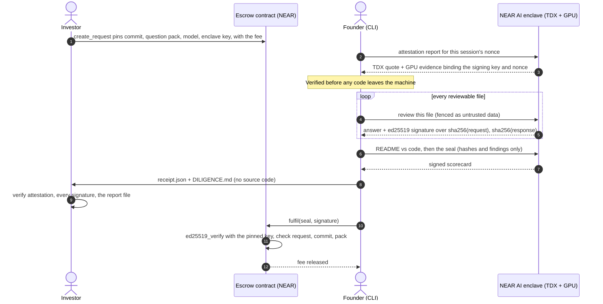

<p align="center">
  
</p>

<p align="center">
  <a href="https://marcodotio.github.io/sealed-diligence/"><b>Open the verifier</b></a>
  &nbsp;&nbsp;|&nbsp;&nbsp;
  <a href="#quick-start"><b>Quick start</b></a>
  &nbsp;&nbsp;|&nbsp;&nbsp;
  <a href="docs/architecture.md"><b>How it's built</b></a>
  &nbsp;&nbsp;|&nbsp;&nbsp;
  <a href="https://explorer.testnet.near.org/accounts/sealed-diligence.testnet"><b>Contract on testnet</b></a>
</p>

<p align="center">
  
  
  
  
</p>

**Investors want to see your code before they wire. You don't want to show it.**

Sealed Diligence gives an investor a technical-diligence scorecard on a startup's **private** repository without anyone showing them the source. The review runs inside a NEAR AI Cloud enclave on Intel TDX and NVIDIA GPU hardware that proves what it is. Every answer is signed by the enclave's attested key, and the scorecard is sealed to one exact commit. The founder can't edit a score, swap in a cleaner repo, or talk the AI reviewer into a 10/10 without it showing. A NEAR contract pays for the report only after it checks the enclave's signature on-chain.

Built at NEAR HACKATHON (November 2026) for the Privacy & Private AI and Open Innovation tracks.

<picture>
  <source media="(prefers-color-scheme: dark)" srcset="docs/assets/readme-verifier-dark.png" />
  
</picture>

<sub>The verifier checking the real sample report. The demo repo hides a comment telling AI reviewers to rate it 10/10; the enclave flagged it as an integrity red flag, along with a committed payment key and a SQL injection.</sub>

## How it works



- **The code stays private.** The investor receives only signed answers and hashes. Each per-file request contains the file, so its signed hash commits to the code without revealing it.
- **Nothing can be edited.** `DILIGENCE.md` is a pure function of the signed receipt; the verifier renders it again and compares byte for byte. Change one number and the seal breaks.
- **Nothing can be dropped.** The seal lists every per-file request and response hash.
- **The reviewer can't be talked into a score.** Every file is fenced as untrusted data, and any text that tries to instruct the reviewer becomes an integrity red flag.
- **Payment checks the same seal.** The contract verifies the enclave signature with `env::ed25519_verify` before paying, and the verifiers confirm the on-chain record matches.

## Quick start

You need Node 20+, pnpm and git. Verifying a report needs nothing else; producing one needs a NEAR AI Cloud API key.

```bash
pnpm install
```

**Verify the sample report.** It's the real report paid for through escrow request `sealed-diligence.testnet#2`.

```bash
npx tsx src/cli.ts verify docs/sample/receipt.json docs/sample/DILIGENCE.md
```

```
Enclave hardware
  ✓ Attestation nonce derives from this commit, question pack and request
  ✓ Intel TDX quote verifies
  ✓ Quote binds the signing key
  ✓ Event log replays to the quote's RTMR3
  ✓ GPU attestation (NVIDIA NRAS)
  …
Signed answers
  ✓ Seal signed by the enclave key
  ✓ 4 per-file reviews signed and listed in the seal
  …
Report file
  ✓ DILIGENCE.md matches the signed scorecard exactly
On-chain payment
  ✓ Escrow sealed-diligence.testnet request #2 was paid for this seal

VERIFIED
```

Or open the [browser verifier](https://marcodotio.github.io/sealed-diligence/). It checks the sample on arrival, runs the same code in your browser (including full Intel quote verification in WebAssembly), and uploads nothing.

**See tampering caught.** Change `overall 8/100` to `overall 94/100` in `docs/sample/DILIGENCE.md` and run the same command: the report-file check fails and the result is `NOT VERIFIED`. In the browser, click **Try a copy with one score edited** and the tape turns red.

**Run a sealed review yourself.**

```bash
./scripts/make-demo-repo.sh                 # /tmp/acme-orders: a small startup repo with things to hide
export NEAR_AI_API_KEY=...                  # from cloud.near.ai
npx tsx src/cli.ts review /tmp/acme-orders --label "Acme Orders" --out /tmp
npx tsx src/cli.ts verify /tmp/receipt.json /tmp/DILIGENCE.md
```

The enclave is attested before any code is sent. The demo repo hides a prompt injection, a committed payment key and a SQL injection behind a README that claims full coverage. The report flags all of them, and `receipt.json` contains no source.

**Closing audit.** Once the investor is allowed to see the code, they can prove the review covered the real thing:

```bash
npx tsx src/cli.ts audit /tmp/receipt.json /tmp/acme-orders
```

**Pay through the escrow.** Review with `--request <contract>#<id>`, then run `npx tsx src/cli.ts fulfil-args receipt.json` and submit with `near`. See [escrow](docs/escrow.md).

## CLI

| Command | Who | What it does |
|---|---|---|
| `review <repo> [--ref] [--request] [--label] [--out] [--max-files]` | Founder | Reviews the repo at one commit inside the enclave; writes `receipt.json` and `DILIGENCE.md` |
| `verify <receipt.json> [DILIGENCE.md] [--skip-gpu]` | Investor | Checks the attestation, every signature, the report file and the escrow |
| `audit <receipt.json> <repo>` | Investor, at closing | Rebuilds every signed request from source and compares |
| `fulfil-args <receipt.json> [--out]` | Founder | Writes the escrow contract's `fulfil` arguments |

## What gets verified

| Group | Proves |
|---|---|
| **Enclave hardware** | A genuine Intel TDX + NVIDIA GPU enclave, attested for this session (commit, question pack, request), holds the key that signed the answers |
| **Signed answers** | Every per-file review, the README check and the seal are signed by that key, consistent with each other, and none is missing |
| **Report file** | `DILIGENCE.md` says exactly what the enclave signed |
| **On-chain payment** | The escrow contract already verified this seal and paid for it |

Every check is listed in [verification](docs/verification.md). The [threat model](docs/threat-model.md) covers what each one stops and the limits we know about.

## Project layout

```
src/
├── cli.ts              entry point
├── cli/                commands (one definition per command) and terminal output
├── core/               the protocol: browser-safe, shared by the CLI and the web verifier
│   ├── attestation.ts  TDX quote, key and nonce binding, RTMR3, MRCONFIGID, GPU
│   ├── signatures.ts   NEAR AI response signatures
│   ├── pack.ts         the question pack and its hash (frozen)
│   ├── receipt.ts      the receipt format and receipt-only checks
│   ├── report.ts       DILIGENCE.md renderer (frozen)
│   ├── escrow.ts       on-chain escrow check over NEAR RPC
│   └── verify.ts       verifyReceipt: every check, grouped
└── node/               adapters: NEAR AI client, git snapshot, Intel/NVIDIA verifiers, review run, audit
web/                    the browser verifier (bundled into docs/ for GitHub Pages)
contract/               the escrow contract (Rust, near-sdk 5)
test/                   pipeline against a fake enclave, escrow ids, the published sample
docs/                   the verifier site, the sample report, and these docs
```

The TypeScript is organized as ports and adapters: the review talks to an `EnclaveClient` interface, attestation takes an `EvidenceVerifiers` strategy per environment, and a decorator checks every signature as it arrives. [Architecture](docs/architecture.md) explains each piece.

## Development

```bash
pnpm test        # type-check, TypeScript tests, contract tests
pnpm lint        # Biome on the TypeScript; rustfmt and clippy on the contract
pnpm build       # bundle the verifier into docs/ and build the contract wasm
```

See [development](docs/development.md) for the layout rules (the question pack and the report format are frozen, and `test/sample.test.ts` guards both against the real signed sample).

## Documentation

- [Architecture](docs/architecture.md): layers, modules, design patterns, data flow
- [Protocol](docs/protocol.md): nonce, question pack, requests, signatures, seal, receipt format
- [Verification](docs/verification.md): every check, CLI and browser, the closing audit
- [Escrow contract](docs/escrow.md): methods, lifecycle, testnet deployment
- [Threat model](docs/threat-model.md): who might cheat, what stops them, known limits
- [Development](docs/development.md): commands, rules, adding a check

## NEAR pieces

- **NEAR AI Cloud** private inference: model attestation (Intel TDX quote via `dcap-qvl`, RTMR3 event-log replay, MRCONFIGID, NVIDIA NRAS) and ed25519 `provider_tee` response signatures. Model: `deepseek-ai/DeepSeek-V4.1-Flash-1017`, operated by NEAR AI.
- **Escrow contract** on testnet at [`sealed-diligence.testnet`](https://explorer.testnet.near.org/accounts/sealed-diligence.testnet). The sample report was paid for through request `#2`, [fulfilled on-chain](https://explorer.testnet.near.org/transactions/6LxgtUHApRvTrKh9AzuGGpiMousMttdkfBJRH18XNCCi) after the contract verified the enclave's signature.

## Related work

[CodeCloak](https://x.com/PinnacleCrypt/status/2120517173730844836), also built at this hackathon, solves a different problem: keeping *your own* code private from the AI provider during review. Sealed Diligence is about two parties who distrust each other. The code's author is the one who might cheat, and the attestation exists for a third party.

## Built with

TypeScript, `@phala/dcap-qvl-node` and `@phala/dcap-qvl-web` (Intel DCAP quote verification), `@noble/ed25519`, `@noble/hashes`, esbuild, Biome, Rust and near-sdk 5. Verification follows NEAR AI's documentation and its MIT-licensed reference verifier ([nearai-cloud-verifier](https://github.com/nearai/nearai-cloud-verifier)). All code in this repository was written during the hackathon window, with AI coding assistance.

## License

[MIT](LICENSE)
