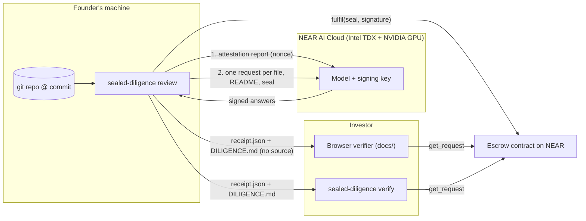

# Architecture

Sealed Diligence has three runtime pieces: a TypeScript CLI the founder and investor run, a static browser verifier, and a NEAR escrow contract. The TypeScript is split into layers so that everything the investor relies on runs the same way in the CLI and in the browser.



## Layers

```
src/
├── cli.ts            entry point (its path is printed in every report; it must not move)
├── cli/              commands and terminal output
├── core/             the protocol: browser-safe, no Node built-ins, shared with web/app.ts
└── node/             Node adapters: NEAR AI client, git, Intel/NVIDIA verifiers, the review run
web/app.ts            the browser verifier (bundled into docs/app.js)
contract/src/lib.rs   the escrow contract
```

The dependency rule: `cli → node → core`, and `web → core`. Nothing in `core/` imports from `node/`, `cli/` or `node:*`, which keeps it bundleable for the browser. `core/pack.ts` reads its one environment variable through `globalThis` for the same reason.

### `core/`: the protocol

| Module | Responsibility |
|---|---|
| `bytes.ts` | Hex, base64 and SHA-256 helpers. |
| `checks.ts` | The `Check` result type, the four check groups, and `allPassed`. |
| `attestation.ts` | Verifies a NEAR AI model attestation (TDX quote, key and nonce binding, RTMR3 replay, MRCONFIGID, GPU). Defines the `EvidenceVerifiers` strategy and the session nonce. |
| `signatures.ts` | Checks one NEAR AI response signature against the attested key. |
| `pack.ts` | The question pack: model, prompts, parameters, request builders and `PACK_HASH`. Frozen (see [protocol](protocol.md)). |
| `receipt.ts` | The `Receipt` format and every check that needs only the receipt. |
| `report.ts` | Renders `DILIGENCE.md` deterministically from a receipt. Frozen. |
| `escrow.ts` | Reads the escrow request over NEAR RPC and compares it with the receipt. |
| `verify.ts` | `verifyReceipt`: runs all of the above and groups the results. |

### `node/`: adapters

| Module | Responsibility |
|---|---|
| `near-ai.ts` | `NearAiCloud`, a client that keeps exact request and response bytes and retries the way NEAR AI documents. |
| `verifiers.ts` | `nodeVerifiers`: Intel quotes via dcap-qvl-node, GPU evidence via NVIDIA NRAS. |
| `enclave.ts` | The `EnclaveClient` port, the `NearAiEnclave` adapter, and the `SignatureCheckingEnclave` decorator. |
| `git.ts` | `GitSnapshot`: a repository frozen at one commit. |
| `review.ts` | `runReview`: attest, review each file, check the README, seal, and build the receipt. |
| `audit.ts` | Node-side `verifyReceiptLocally` and the closing audit against source. |

## Design patterns

- **Ports and adapters.** The review depends on the `EnclaveClient` interface, not on NEAR AI. `NearAiEnclave` adapts the real service; the tests plug in a local ed25519 key that signs exactly the payload NEAR AI signs, so every downstream check runs for real.
- **Strategy.** `EvidenceVerifiers` is the environment-specific half of attestation. The CLI verifies quotes with dcap-qvl-node and asks NVIDIA about the GPU. The browser uses dcap-qvl compiled to WebAssembly and a CORS-enabled Intel collateral mirror, and reports the GPU check as "needs the CLI".
- **Decorator.** `SignatureCheckingEnclave` wraps an enclave so every completion is verified against the attested key as it returns. A bad signature stops the run instead of reaching the receipt.
- **Repository.** `GitSnapshot` hides `git ls-tree` and `git show` behind `paths()`, `read()`, `readme()` and `reviewableFiles()`, always at one commit and never from the working tree.
- **Command.** Each CLI command is an object declaring its synopsis, options and description. Argument parsing (`node:util` `parseArgs`) and the usage screen come from that single definition.
- **Pure rendering.** `DILIGENCE.md` is a pure function of the receipt. That is what makes "re-render and compare byte for byte" a tamper check.

## Data flow of a review

1. `GitSnapshot.at(repo, ref)` resolves the commit and lists the tracked files. Reviewable source and config files are read at that commit (binaries skipped, files over 48 KB truncated and marked).
2. A random salt and `sessionNonce(commit, packHash, requestId, salt)` produce the attestation nonce.
3. `NearAiEnclave.attest(nonce)` fetches the attestation report and verifies every candidate in full. The run stops unless all pass and agree on one signing key. **No code has left the machine yet.**
4. Each file goes in its own request (`fileRequest`), at most four at a time. The `SignatureCheckingEnclave` verifies each signature on arrival.
5. The README is checked against the per-file one-line purposes (`readmeRequest`).
6. The seal request (`sealRequest`) carries every per-file request and response hash and the findings, never source. The enclave aggregates it into the scorecard.
7. The receipt holds the attestation, every signed answer (request bodies withheld, hashes kept), and the full seal request. `renderDiligence` turns it into `DILIGENCE.md`.

See [verification](verification.md) for what the investor checks, and [escrow](escrow.md) for payment.
