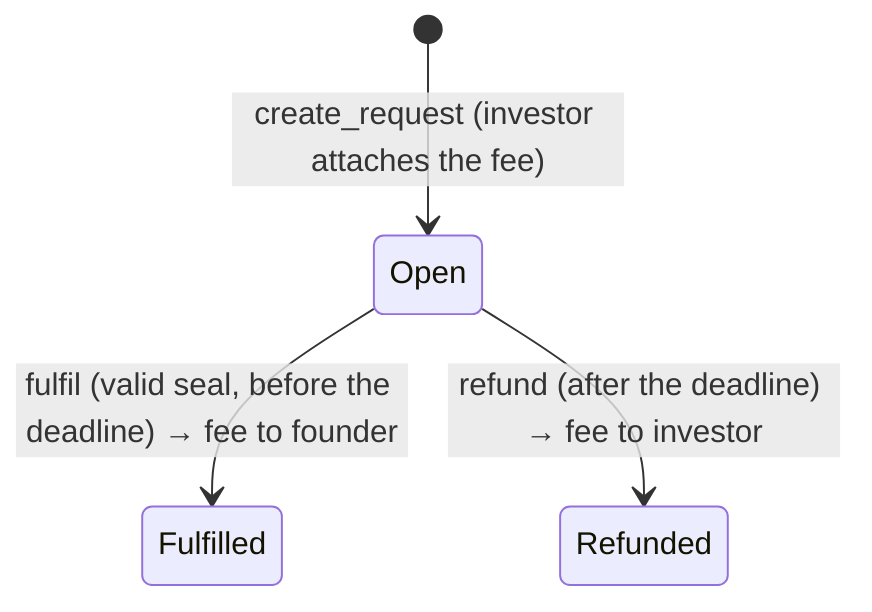

# Escrow contract

`contract/src/lib.rs` (near-sdk 5) holds the investor's fee and releases it to the founder only after checking the enclave's signature on-chain. It's deployed on testnet at [`sealed-diligence.testnet`](https://explorer.testnet.near.org/accounts/sealed-diligence.testnet). The sample report was paid for through request `sealed-diligence.testnet#2` ([fulfil transaction](https://explorer.testnet.near.org/transactions/6LxgtUHApRvTrKh9AzuGGpiMousMttdkfBJRH18XNCCi)).



## Methods

| Method | Who | What it checks |
|---|---|---|
| `create_request(founder, commit, pack_hash, model, enclave_key, timeout_hours)` | Investor, with the fee attached | A non-zero fee; a 40-hex commit; a 32-byte pack hash and enclave key; a timeout between 1 hour and 90 days. The request id becomes `<contract>#<n>`. |
| `fulfil(id, seal_request_body, seal_text, signature_hex)` | Anyone (the fee always goes to the founder) | See below |
| `refund(id)` | Anyone (the fee always goes to the investor) | The request is open and its deadline has passed |
| `get_request(id)` | View | |
| `next_id()` | View | |

`fulfil` requires, in order:

1. The request is open and its deadline hasn't passed.
2. The signed text is `<model>:<request hash>:<response hash>`, where the model is the pinned model and the request hash is `sha256(seal_request_body)`.
3. `env::ed25519_verify(signature, seal_text, enclave_key)` with the **pinned** key.
4. The seal request names the pinned model, and its seal input names this request id, commit and question pack.

It then marks the request `Fulfilled`, stores the seal text (which the verifiers compare with the receipt), and transfers the fee to the founder.

The investor pins the enclave key they verified off-chain. Running `sealed-diligence verify` (or the browser verifier) on any recent receipt, or `scripts/check-attestation.ts`, prints the current attested key.

## Using it

```bash
cd contract && cargo near build non-reproducible-wasm

# Investor: pin what will be reviewed and attach the fee
near contract call-function as-transaction sealed-diligence.testnet create_request \
  json-args '{"founder":"<founder>","commit":"<sha>","pack_hash":"<pack>","model":"deepseek-ai/DeepSeek-V4.1-Flash-1017","enclave_key":"<key>","timeout_hours":72}' \
  prepaid-gas '30 Tgas' attached-deposit '1 NEAR' sign-as <investor> network-config testnet

# Founder: review against that request, then submit the seal
npx tsx src/cli.ts review <repo> --request "sealed-diligence.testnet#<id>"
npx tsx src/cli.ts fulfil-args receipt.json
near contract call-function as-transaction sealed-diligence.testnet fulfil file-args fulfil-args.json \
  prepaid-gas '100 Tgas' attached-deposit '0 NEAR' sign-as <founder> network-config testnet
```

`pnpm exec tsx -e 'import("./src/core/pack.ts").then(m => console.log(m.PACK_HASH))'` prints the current pack hash.

## Tests

`cd contract && cargo test` covers: a valid seal pays; a seal signed by another key, for another commit, or with a swapped request body is rejected; a late seal is rejected; a refund before the deadline is refused; a refund after it succeeds.
